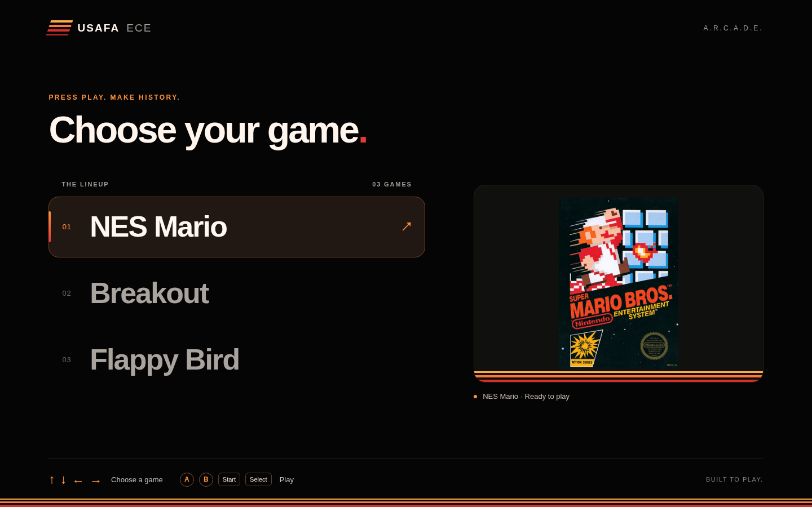

# ece383-arcade

Applied Reconfigurable Computing And Digital Electronics.

This cabinet uses a Raspberry Pi menu, a Nexys Video FPGA, and an Arduino Due that reads two sets of arcade controls. The Due sends either USB keyboard input to the Pi or two NES controller streams to the FPGA according to the HDMI switch's source-status signal.

## Cabinet wiring and physical view

The [wiring guide](design/README.md) includes the Due pin map, JA connector orientation, power rails, LED and HDMI-status level shifters, and bill of materials. The [compatibility review](design/REPOSITORY-COMPATIBILITY.md) records the differences from the existing controller code and the checks still needed on hardware.


Open the self-contained Fritzing sketches in Breadboard view:

- [Cabinet interconnect](design/01-arcade-system.fzz)
- [Controls and JA pin wiring](design/02-controls-and-ja.fzz)
- [LED and HDMI interfaces](design/03-led-and-hdmi-interfaces.fzz)
- [Physical wiring view](design/04-realistic-breadboard.fzz)

The physical view uses Fritzing Due artwork and representative Pi 4B artwork; the actual Pi model is unspecified. Other components are illustrated. The JA inset and interface assembly are not mechanical or fabrication drawings. See [artwork attribution](design/assets/ATTRIBUTION.md).

### JA connector: front / mating face


This redraw follows the supplied cabinet reference: **JA6 is upper left, JA1 upper right, JA12 lower left, and JA7 lower right** when looking into the board socket, with the PCB below it. A view from the wire side is mirrored. The image includes both NES controllers and JA4 for the trackball LEDs. [Full-size SVG](design/previews/ja-port.svg) · [Detailed pin map and pull-ups](design/README.md#ja-pin-map).

## Controller firmware variants

| Firmware | Behavior |
| --- | --- |
| [Existing controller example](controllers/due_interface.c) | Both Start buttons pulse Due D9 to switch HDMI; D8 gates Pi HID, but NES emulation stays active. |
| [Manual-switch Arduino sketch](design/reference/arcade_due_manual_switch/arcade_due_manual_switch.ino) | Silver button switches HDMI directly. D8 reads translated status and enables only Pi HID or FPGA NES output. D9 is unused. |

Use the manual-switch sketch for the wiring shown here. Its project folder can be opened with the Arduino IDE for an Arduino Due with Native USB support. The sketch is a hardware-unverified implementation draft; the legacy example is preserved.

Both use button order **A, B, Select, Start, Up, Down, Left, Right**, on D22-D29 for Player 1 and D30-D37 for Player 2. Every player switch connects to GND and uses an internal pull-up. NES latch/clock/data pins are D2/D3/D4 and D5/D6/D7. The revised wiring adds two 10 kohm data pull-ups to FPGA JA6 3.3 V for open-drain NES output.

The manual-switch sketch defaults to **D8 HIGH = Pi selected**. Measure the switch status before use; invert `PI_SELECTED_LEVEL` if necessary. It releases both destinations during status transitions. Both players can navigate the Pi with arrows, `a`, `b`, Enter and Space; they remain independent NES controllers in FPGA mode.

## Pi software and hardware checks

`server/fpgaloader.php` loads bitstreams over the Pi-to-Nexys USB JTAG cable using `openFPGALoader -b nexysVideo`. The reviewed Pi sources do not use GPIO. The HDMI button is independent of both Pi and Due outputs.

`server/index.php` is the game-selection kiosk, with arcade keyboard navigation and artwork from the CSV game library. `kiosk/index.htm` remains a separate keypress diagnostic. The repository contains compiled game bitstreams without their HDL/XDC sources, so their LED, trackball, audio and NES timing compatibility must be checked separately. The trackball remains connected to the FPGA even while Pi video is selected.

## Run the PHP web server on the Pi

The Pi must execute PHP to serve the loader. Run these commands in a terminal on the Pi, using a local checkout of this repository. On Raspberry Pi OS / Debian, install PHP CLI and openFPGALoader:

```sh
sudo apt update
sudo apt install php-cli openfpgaloader
cd ~/ece383-arcade
php -v
openFPGALoader --list-boards
```

Confirm that `nexysVideo` appears in the board list. Connect a USB data cable from the Pi to the Nexys Video **PROG / USB-JTAG** port and power the FPGA board from its normal supply. This is separate from the trackball's USB HOST connection. The same user who starts PHP needs access to the USB programmer. If access is denied, install/check the openFPGALoader udev rules and their `plugdev` or `dialout` group membership, then log out/in and reconnect the cable; see the [official installation guide](https://trabucayre.github.io/openFPGALoader/guide/install.html#udev-rules).

From the repository root, start the web server:

```sh
php -S 127.0.0.1:8000 -t server
```

Leave that terminal running. Open **http://127.0.0.1:8000/** in the Pi's browser; `server/index.php` is served automatically. Each game link requests `fpgaloader.php?name=FILENAME.bit`, and the loader runs `openFPGALoader -b nexysVideo` for that file. With this document root, the URL is `/fpgaloader.php`, without a `/server/` prefix. Stop the server with Ctrl+C. PHP's [`-S` and `-t` options](https://www.php.net/manual/en/features.commandline.webserver.php) provide this local web server and select its document root.

The menu uses the cabinet's black, red and orange styling, large game titles, and a rounded highlight for the current selection. The first game starts selected; navigation wraps at either end. Mouse/touch clicks and standard Tab/Enter navigation also work. The page uses local CSS, JavaScript, images and system fonts, with no CDN dependency.



| Arcade control | Due keyboard key | Menu action |
| --- | --- | --- |
| Up / Left | ArrowUp / ArrowLeft | Previous game |
| Down / Right | ArrowDown / ArrowRight | Next game |
| A / B | `a` / `b` | Load the selected game in the background |
| Select | Space | Load the selected game in the background |
| Start | Enter | Load the selected game in the background |

Either player's controls work with the manual-switch Due sketch. Selecting a game sends a background request to `fpgaloader.php` while the menu stays visible behind a loading dialog. The loader returns JSON with success/failure based on openFPGALoader's exit code. Success tells the user to switch the display to FPGA with the silver button; failure reports that loading was unsuccessful. Both result dialogs wait for a fresh keypress (or the Continue button) before returning to the same menu selection. Holding the launch button or pressing buttons while loading does not dismiss the result or start another load.

[Successful-load dialog preview](design/previews/kiosk-load-success.png).

The silver button still switches HDMI independently. After selecting FPGA video, the Due routes arcade inputs to the FPGA, so the Pi's result dialog remains until it receives a key again (for example, after switching back to Pi video).

For a direct load of an existing game, visit:

```text
http://127.0.0.1:8000/fpgaloader.php?name=C25Dutt_FinalProject_Mario.bit
```

That URL immediately reprograms the FPGA and displays a standalone HTML result with programmer output. The loader resolves filenames relative to **`server/bitstreams/`** and quotes the path as one shell argument. New games need a `.bit` file there and a row in `server/bitstreams.csv`; the column order is `Title,Bitstream File Name,Picture File Name,Description`. Put optional pictures in `server/images/`.

The standalone loader page shows the programmer's output. If loading fails, run the same command as the PHP user to see the underlying error:

```sh
openFPGALoader -b nexysVideo server/bitstreams/C25Dutt_FinalProject_Mario.bit
```

If the programmer is unavailable, check `php --ini` and the CLI configuration's `disable_functions`; the loader requires PHP's `exec` function and `openFPGALoader` in PHP's inherited `PATH`. The command loads volatile FPGA configuration memory; it must be repeated after power loss. See [openFPGALoader first steps](https://trabucayre.github.io/openFPGALoader/guide/first-steps.html#programming-a-development-board).

The loopback binding is for the browser running on the Pi. Keep this unauthenticated FPGA-programming endpoint local to the cabinet; PHP's built-in server is intended for development and controlled demonstrations. It must be running before the kiosk browser opens the menu. This command starts it manually and does not install a boot service.

## Package an ELF inside a bitstream

For a MicroBlaze game, embed the compiled program into the FPGA's block RAM initialization so the PHP loader only needs the resulting `.bit`. Do this on the **Vivado/Vitis development workstation**, then copy the packaged bitstream to the Pi. The Pi does not need Vivado or Vitis to load it.

You need the hardware design's **matching implemented `.bit` and `.mmi`**, plus an **ELF built for that design's processor and memory map**. The program sections being embedded must fit the mapped block RAM. An application linked into external DDR needs a separate boot/loading strategy; this step does not embed a DDR image into BRAM. These source/build inputs are not included with this repository's existing compiled game bitstreams.

### Use the included ELFintoBIT Tcl helper (classic Vitis / XSCT)

1. Generate the hardware bitstream in Vivado and export its hardware platform **including the bitstream**. Build the corresponding Vitis platform and application. The helper expects the platform XSA under `WORKSPACE/PLATFORM/hw/`, the imported `.bit` and `.mmi` under `WORKSPACE/APP/_ide/bitstream/`, and `APP/Release/APP.elf` or `APP/Debug/APP.elf`.
2. In classic Vitis, open **Vitis → XSCT Console**. Source the repository's script, then select the workspace and application. Replace the example absolute paths and `my_game` application name; keep paths free of spaces because this helper splits arguments on spaces. Use forward slashes on Windows as well.

```tcl
source /home/you/ece383-arcade/ELFintoBIT.tcl
ELFintoBIT -w /home/you/vitis-workspace -a my_game -o /home/you/my_game_with_elf.bit
```

3. Check that the console reports successful `updatemem` execution and lists the output file. Without `-o`, the default output is `WORKSPACE/APP/_ide/bitstream/download.bit`. **Release takes precedence over Debug** if both ELFs exist; ensure the selected build is current. Rebuild/repackage after changing the software.
4. Optionally add `-d` to generate and download to an attached FPGA, or use `ELFintoBIT -l` to download the last generated result. These options need a board connected to the development workstation; they are unnecessary when copying the result to the Pi.

The helper invokes `updatemem` and the shell tools `unzip`, `grep`, `cp`, and `rm`; make those available in its environment. For a terminal XSCT session, source your installed Vitis `settings64.sh`, run `xsct`, then use the same Tcl commands. The included [ELFintoBIT guide](ELFintoBIT_README.html) has more options. Its Unified IDE section describes Python/wrapper files that are **not included in this repository**; use the direct method below if those files or XSCT workspace support are unavailable.

### Use UpdateMEM directly

Source your installed Vivado `settings64.sh` to put `updatemem` on `PATH`. From your hardware/software build directory, replace these example filenames and the processor instance path:

```sh
mkdir -p packaged
updatemem -force \
  -meminfo build/design_1_wrapper.mmi \
  -bit build/design_1_wrapper.bit \
  -data software/Debug/my_game.elf \
  -proc design_1_i/microblaze_0 \
  -out packaged/my_game_with_elf
```

This produces `packaged/my_game_with_elf.bit`. Set `-proc` to the exact `Processor` element's `InstPath` in your `.mmi`; `design_1_i/microblaze_0` is an example. Use the `.mmi` from the same hardware build as the unencrypted input `.bit`. UpdateMEM maps ELF contents into the described block RAM; no new hardware implementation is needed for a software-only update that still fits that memory map. See AMD's [UpdateMEM overview](https://docs.amd.com/r/2023.1-English/ug1580-updatemem/Introduction) and [command arguments](https://docs.amd.com/r/en-US/ug1580-updatemem/Arguments-for-updatemem).

Copy the resulting `.bit` into the Pi checkout's `server/bitstreams/`, add its CSV entry, and load it through the PHP menu. Verify that the program starts after programming **without a Vitis debugger downloading a separate ELF**; that is the end-to-end check that the packaged image contains the program and boots correctly.

## Rebuild and validation

Python 3 and a C++11-capable `g++` are needed for the checks. Inkscape is only needed to render a PNG preview.

```sh
python3 tools/build_realistic.py
python3 tools/build_ja_port.py
python3 tools/validate_design.py
python3 tools/test_due_firmware.py
python3 tools/test_kiosk_catalog.py
python3 tools/test_fpga_loader.py
inkscape design/previews/04-realistic-breadboard.svg --export-type=png --export-filename=design/previews/04-realistic-breadboard.png --export-width=2800
inkscape design/previews/ja-port.svg --export-type=png --export-filename=design/previews/ja-port.png --export-width=1800
```

The builders regenerate all four native sketches, SVG previews, endpoint metadata and custom parts. Generated raw `.fz` files and `design/parts/` are ignored because the `.fzz` sketches embed their parts.

The validator checks archive/SVG integrity, reciprocal connector links, upstream pin compatibility, supply separation and manual-switch routing. Firmware tests run against mocked Arduino and Keyboard APIs; they do not establish SAM3X interrupt timing or compile for the actual Due board. The kiosk catalog tests require PHP CLI and check CSV handling, HTML escaping and empty/error states. Loader tests use a fake programmer to verify exit-status handling, path quoting and error responses without programming hardware. Native Fritzing application opening/export and hardware behavior remain unverified.
